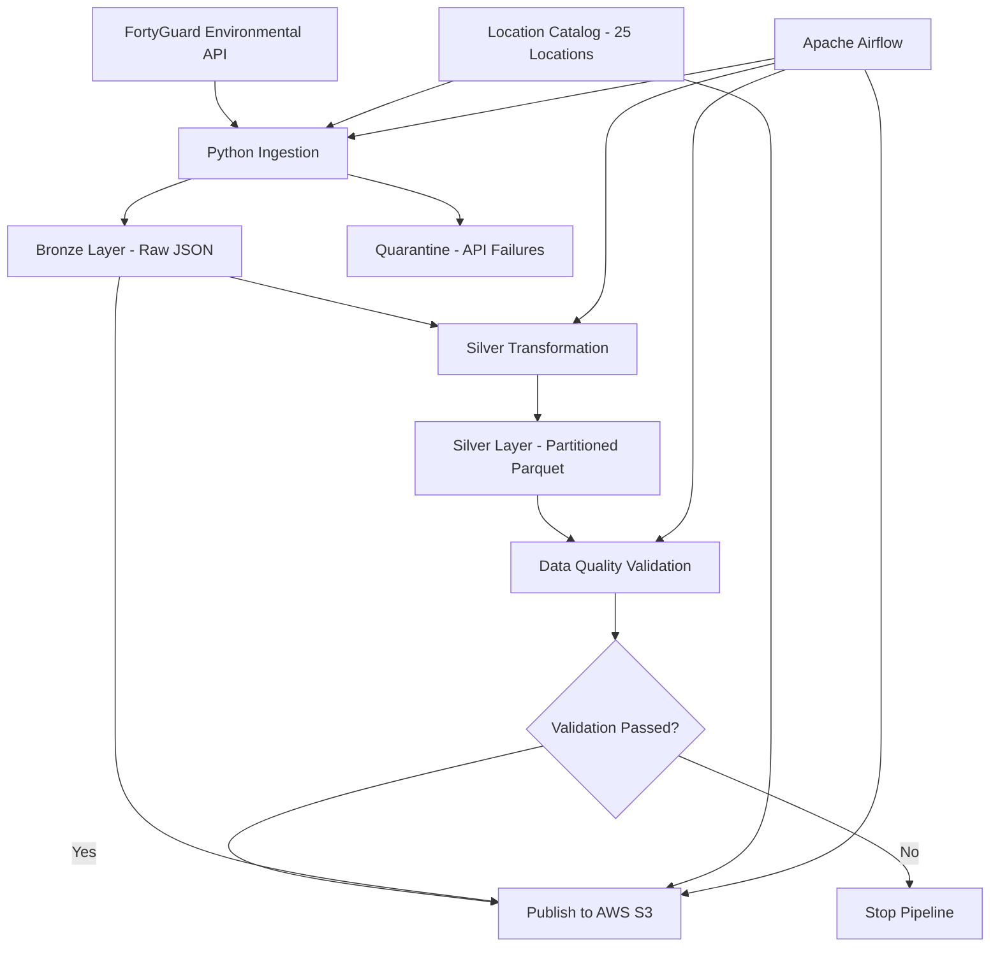

# FortyGuard Environmental Data Engineering Pipeline

An automated data engineering pipeline that collects environmental data from the FortyGuard API, stores raw API responses in an AWS S3 Bronze layer, transforms them into partitioned Parquet files in a Silver layer, validates data quality, and publishes the results to Amazon S3.

## Project Overview

This project was developed as a practical Data Engineering project for the FortyGuard Data Engineer Internship (January 2027).

The pipeline processes environmental observations for 25 locations in Phoenix, Arizona. It uses Apache Airflow to orchestrate the workflow and AWS S3 for cloud storage.

### Project Objectives

- Ingest environmental data from the FortyGuard API.
- Support historical and hourly data ingestion.
- Maintain raw API responses in a Bronze layer.
- Transform and clean data into a Silver layer.
- Partition analytical data by observation date.
- Validate data quality before publishing.
- Store the resulting data in Amazon S3.
- Orchestrate the workflow using Apache Airflow.

## Architecture



## Technology Stack

| Technology | Purpose |
|---|---|
| Python | API ingestion and data processing |
| FortyGuard API | Environmental data source |
| Apache Airflow 2.10.5 | Workflow orchestration |
| Docker Compose | Local containerized environment |
| PostgreSQL | Airflow metadata database |
| DuckDB | Data inspection and validation |
| Pandas | Data processing |
| PyArrow | Parquet processing |
| Boto3 | AWS integration |
| Amazon S3 | Cloud data storage |
| PyGeohash | Geospatial geohash support |
[Airflow DAG](airflow-dag-success.png)

## Data Pipeline

### 1. Source Data Ingestion

The pipeline connects to the FortyGuard environmental API.

It supports two ingestion modes:

- Historical ingestion
- Hourly ingestion

The API uses an asynchronous request workflow. The ingestion process submits requests, receives activity IDs, checks their status, and retrieves the completed results.

Raw API responses are stored as JSON files in the Bronze layer.

### 2. Bronze Layer

The Bronze layer preserves the original API responses.

Each record contains information such as:

- Location ID
- Request timestamp
- Original request parameters
- Initial API response
- Activity ID
- API result

API failures are stored separately in a quarantine directory to preserve information about unsuccessful requests.

### 3. Silver Layer

The Silver transformation process reads Bronze JSON files and converts the data into structured records.

Main processing operations:

- Extract environmental measurements.
- Associate observations with the location catalog.
- Add geohash information.
- Standardize timestamps.
- Add ingestion metadata.
- Remove duplicate observations.
- Validate required fields and measurement ranges.
- Export partitioned Parquet files.

The Silver output is partitioned by:

`observation_date`

The transformation currently performs a full refresh from the available Bronze files on each execution. It produces deduplicated, repeatable Silver output rather than implementing a true incremental merge.

### 4. Data Quality Validation

A separate validation script runs before publishing the data.

It checks:

- Silver data is not empty.
- Required fields are not null.
- Duplicate observations do not exist.
- Relative humidity is within the valid 0–100 range.
- Precipitation is not negative.

If validation fails, the process exits with an error and prevents the upload task from running.

### 5. AWS S3 Storage

The pipeline publishes the data to Amazon S3.

Bucket:

`fortyguard-temperature-catalog-ahmed-2026`

Region:

`eu-north-1`

S3 structure:

```text
fortyguard-temperature-catalog-ahmed-2026/
│
├── bronze/
│   └── raw_api_responses/
│       └── *.json
│
├── silver/
│   └── environment_observations/
│       ├── observation_date=2025-09-20/
│       │   └── *.parquet
│       │
│       └── observation_date=2026-11-07/
│           └── *.parquet
│
└── reference/
    └── location_catalog.csv
```

The upload process uses a staging prefix for Silver files, verifies the published objects, and removes obsolete objects after successful publication.

S3 objects are uploaded with server-side encryption using AES-256.

## Apache Airflow Orchestration

The workflow is managed by an hourly Airflow DAG.

DAG ID:

`fortyguard_hourly_pipeline`

Task sequence:

```text
ingest_fortyguard_api
        |
        v
transform_bronze_to_silver
        |
        v
validate_silver
        |
        v
upload_to_s3
```

The DAG includes:

- Hourly scheduling
- Retry configuration
- Task execution timeouts
- Sequential task dependencies
- Maximum one active DAG run
- Catchup disabled

The workflow ensures that data is validated before it reaches the cloud storage destination.

## Project Results

Latest verified Silver output:

| Metric | Result |
|---|---:|
| Locations in catalog | 25 |
| Silver observations | 50 |
| Duplicate observations | 0 |
| Rows with null key fields | 0 |
| Invalid measurements | 0 |
| Validation status | PASSED |

The Silver dataset contains historical and hourly observations.

The Bronze JSON files, Silver Parquet files, and location reference catalog were successfully published to Amazon S3.

## Project Structure

```text
fortyguard-project/
│
├── airflow/
│   ├── dags/
│   │   └── fortyguard_pipeline.py
│   ├── config/
│   ├── logs/
│   ├── plugins/
│   └── Dockerfile
│
├── data/
│   ├── bronze/
│   ├── reference/
│   │   └── location_catalog.csv
│   ├── silver/
│   │   └── environment_observations/
│   └── quarantine/
│       └── api_failures/
│
├── src/
│   ├── ingest.py
│   ├── transform_silver.py
│   ├── validate_silver.py
│   ├── verify_silver.py
│   └── upload_to_s3.py
│
├── tests/
│   └── test_transform_silver.py
│
├── requirements.txt
├── docker-compose.yaml
├── .env
└── README.md
```

## Running the Project

### Prerequisites

- Python 3.11
- Docker Desktop
- Docker Compose
- AWS CLI
- AWS account with access to the target S3 bucket
- FortyGuard API key

### 1. Clone the Repository

```bash
git clone YOUR_GITHUB_REPOSITORY_URL
cd fortyguard-project
```

### 2. Configure Environment Variables

Create a `.env` file:

```env
FORTYGUARD_API_KEY=your_api_key
```

Configure AWS credentials using the AWS CLI:

```bash
aws configure
```

Use an IAM identity with the permissions required to access the project bucket.

### 3. Build the Airflow Image

```bash
docker compose build
```

### 4. Initialize Airflow

```bash
docker compose up airflow-init
```

### 5. Start Airflow

```bash
docker compose up -d airflow-webserver airflow-scheduler
```

Open:

`http://localhost:8080`

### 6. Run the Pipeline

Enable the DAG:

```bash
docker compose exec airflow-scheduler airflow dags unpause fortyguard_hourly_pipeline
```

Trigger a manual run:

```bash
docker compose exec airflow-scheduler airflow dags trigger fortyguard_hourly_pipeline
```

### 7. Stop the Environment

```bash
docker compose down
```

## Testing

Run the transformation tests:

```bash
python -m pytest tests/ -v
```

Run data quality validation:

```bash
python src/validate_silver.py
```

Inspect the Silver dataset:

```bash
python src/verify_silver.py
```

## Security Considerations

- API credentials are stored in environment variables.
- AWS credentials are not included in the repository.
- The `.env` file must be excluded from Git.
- AWS credentials are mounted read-only into Airflow containers.
- S3 objects use AES-256 server-side encryption.
- The local Airflow configuration is intended for development, not public production deployment.

## Current Limitations and Future Improvements

The current implementation is a working demonstration of an orchestrated environmental data pipeline.

Potential improvements:

1. Implement incremental Silver processing instead of full refreshes.
2. Add automated unit and integration tests to the Airflow workflow.
3. Add structured logging and pipeline monitoring.
4. Add notifications for failed DAG runs.
5. Add automated infrastructure provisioning using Terraform.
6. Deploy Airflow in a persistent cloud environment.
7. Improve S3 publishing with a more robust versioned publication strategy.

## Key Engineering Concepts Demonstrated

- REST API ingestion
- Asynchronous API polling
- Bronze and Silver data architecture
- Data transformation and deduplication
- Data quality checks
- Partitioned Parquet storage
- Apache Airflow orchestration
- Docker-based development
- AWS S3 integration
- Secure credential management
- Failure handling and quarantine
- Cloud data publishing

---

**Project:** FortyGuard Environmental Data Engineering Pipeline  
**Focus:** Data Engineering, API Integration, Workflow Orchestration, AWS Cloud Storage  
**Status:** Core pipeline implemented and successfully tested.
# fortyguard-environmental-data-pipeline
